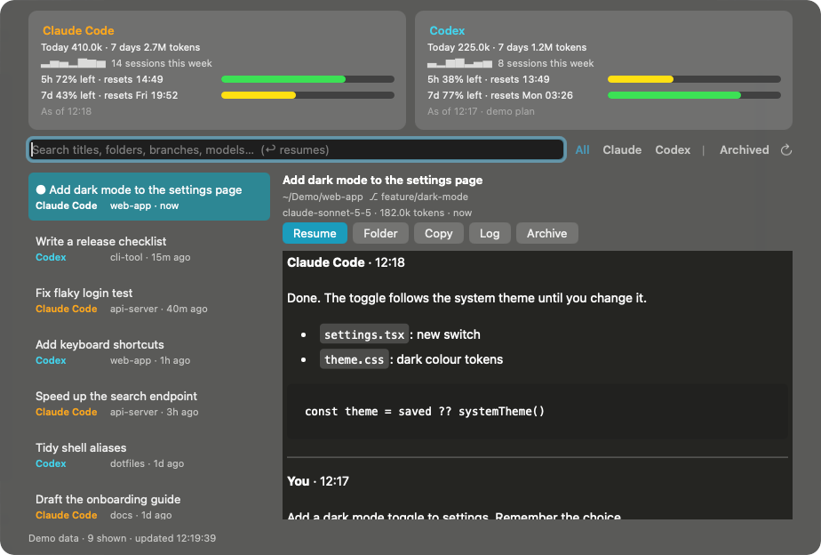
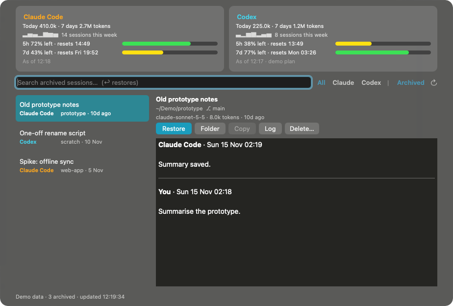

# alfred-ai-dashboard-workflow



An [Alfred 6](https://www.alfredapp.com/) workflow for browsing [Claude Code](https://www.anthropic.com/claude-code) and [Codex](https://openai.com/codex/) sessions, usage and limits.

## Installation

1. [Download the workflow](https://github.com/ar-rhc/alfred-ai-dashboard-workflow/releases/latest)
2. Double click the `.alfredworkflow` file to install

Note that the [Alfred Powerpack](https://www.alfredapp.com/powerpack/) is required to use workflows.

### Requirements

- Alfred 6
- `python3` for the dashboard, included with Apple's Command Line Tools (`xcode-select --install`). Without it the dashboard tells you how to install it
- Claude Code and/or Codex, used at least once. Turn off the one you do not use.
- Optional: `tmux`, and `zstd` to preview older Codex sessions that Codex compressed

## Usage

Type `aidash` to open the dashboard.

### Browse and resume

1. Search, or filter by tool with `⌘1`, `⌘2` and `⌘3`
2. Select a session to preview its latest messages
3. Press `enter` or double click to resume it in your terminal, in tmux if you use it

Right click a session for more actions. `⌘R` refreshes. If you open the dashboard in a separate window, it matches your Alfred theme's light or dark look.

### Archive and restore

1. Press **Archive** on a session and confirm
2. Open **Archived** (`⌘4`) to **Restore** or delete it

Claude Code sessions are archived to `ai-dashboard-archive` inside the Claude folder. Codex sessions use `codex archive`. **Delete Permanently** cannot be undone. Open sessions cannot be archived or deleted.



### Sample data

Type `aidash demo` or `aidash demo archived` to look around with invented sessions.

## Claude Code limits

Claude Code gives its limits to the status line. In Claude Code, use `/statusline` to set it up:

```text
/statusline keep my status line as it is, and when rate_limits is present save that object to ~/.claude/ai-dashboard-rate-limits.json
```

Until then, the dashboard shows the figures Claude Code last cached in `~/.claude.json`, which can be hours old. The newer reading is used, with its time.

## Configuration

Open **Configure Workflow** to choose the tools shown, their data folders, the terminal (system default, Apple Terminal, iTerm, Ghostty or a custom command), tmux behaviour, list and preview size, limits shown as left or used, refresh rate, resume options and whether permanent deletion is allowed.

## Privacy

Everything is read from local folders (`~/.claude` and `~/.codex` unless changed) and nothing is sent anywhere. From `~/.claude.json` only the cached usage figures are used. Titles and short message excerpts are cached in the workflow's cache folder. Turn previews off to keep message text out of it; generated titles are still cached.

## Limitations

- Tested with Alfred 6.0.3, Claude Code 2.1.331 and Codex 0.172.0. Both tools use internal file formats that may change.
- Limits show the last saved reading, with its time.
- Token figures are uncached input plus output counted from local logs, not billing figures.
- iTerm asks "OK to run?" on each resume.

This project is not affiliated with Anthropic, OpenAI or Alfred.

## Development

- `ai-dashboard/` holds everything that goes in the package
- `scripts/run` starts `scripts/dashboard.py`; the code is in `scripts/aidash/`, one module per job
- Repeated parts of the window are `templates` in `ui.json`
- Tests: `/usr/bin/python3 -m unittest discover -s tests`
- Package: `cd ai-dashboard && zip -r -X ../ai-dashboard.alfredworkflow info.plist icon.png ai-dashboard.alfredui`

## AI assistance

AI assistance: Claude Code helped write the code and documentation.

## License

Code released under the [MIT License](LICENSE).
